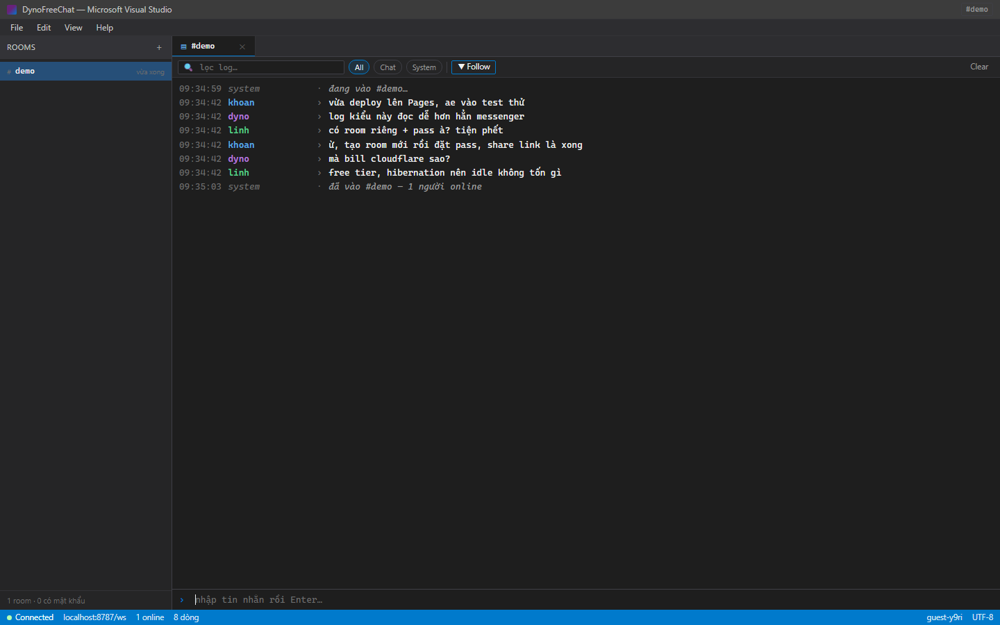

# DynoFreeChat

Chat room nhiều phòng, giao diện giả lập **Visual Studio 2022 dark** — mỗi tin nhắn là một dòng log. Frontend tĩnh trên **GitHub Pages**, realtime bằng **Cloudflare Worker + Durable Objects**, mỗi phòng có thể đặt **mật khẩu**.



## Tính năng

- **Nhiều phòng**, tạo bằng tên (slug), vào bằng link `?r=<slug>`.
- **Mật khẩu phòng tuỳ chọn** — kiểm tra ở server, không lưu plaintext, không đi qua URL.
- Mỗi tin nhắn = một dòng log: `HH:MM:SS  nick  ›  nội dung`, cột thẳng hàng, màu nick theo người.
- **Optimistic echo**: gõ là thấy dòng mờ ngay, server xác nhận thì sáng lên.
- **Reconnect** tự động với backoff 1s→30s có jitter; lịch sử được replay lại, dedupe theo id.
- **Lọc log** (Ctrl+F, substring trên nick + nội dung) và chip All/Chat/System.
- **Follow tail** tự cuộn khi ở đáy, tự tắt khi bạn cuộn lên, chip "↓ tin mới".
- Trạng thái kết nối ở status bar; phím tắt Ctrl+L (xoá view), Ctrl+N (tạo room), Ctrl+End (xuống đáy).
- Danh mục room ở sidebar kiểu Solution Explorer, refresh mỗi 30s.

Không có: đăng nhập, avatar, upload file, emoji picker, sửa/xoá tin, DM, thread.

## Kiến trúc

```
GitHub Pages (static, 0 dependency)          Cloudflare Workers (Free)
┌────────────────────────────┐   wss://   ┌────────────────────────────────┐
│ web/  Vite + TypeScript    │ ─────────► │ worker/ index.ts               │
│  ui/    IDE chrome         │            │  GET  /api/rooms  (lobby)      │
│  net/   socket + backoff   │            │  POST /api/rooms  (tạo room)   │
│  model/ store (thuần)      │            │  GET  /ws?r=<slug> → room DO   │
│  styles/ tokens + IDE      │            │        │            │          │
└────────────────────────────┘            │        │            │          │
                                          │        ▼            ▼          │
shared/src/protocol.ts ◄──────────────────┤  Registry DO    ChatRoom DO×N  │
  types + validator + token bucket        │  (danh mục,     (messages,     │
                                          │   hash pass)     WebSocket)    │
                                          └────────────────────────────────┘
```

- `Registry` là nguồn sự thật duy nhất về phòng và hash mật khẩu. `ChatRoom` không biết mật khẩu, mỗi lần join hỏi `Registry`.
- Mỗi phòng là một Durable Object riêng, dùng **WebSocket Hibernation API** + **SQLite storage** (500 tin gần nhất, trim theo lô 50).
- Không D1, không KV, không database nào khác.

## Chạy local

```bash
npm install                 # npm workspaces: shared / worker / web
npm run dev:worker          # terminal 1 → http://127.0.0.1:8787
npm run dev:web             # terminal 2 → http://localhost:5173
```

Mở hai tab `http://localhost:5173`, bấm `+` để tạo room, hoặc seed dữ liệu mẫu:

```bash
node scripts/seed-demo.mjs demo            # room mở
node scripts/seed-demo.mjs team matkhau    # room có mật khẩu
```

Kiểm tra:

```bash
npm run typecheck   # tsc trên cả 3 workspace
npm test            # 27 shared + 20 worker + 42 web
npm run build       # bundle production vào web/dist
```

## Deploy

### 1. Worker (Cloudflare)

```bash
npx wrangler login                       # cần browser của bạn
cd worker && npx wrangler deploy
```

Ghi lại URL dạng `https://dynofreechat-api.<subdomain>.workers.dev`.
Biến `ALLOWED_ORIGINS` trong `worker/wrangler.jsonc` phải chứa origin của trang Pages
(`localhost` là token đặc biệt: cho phép mọi cổng loopback khi dev).

### 2. Frontend (GitHub Pages)

```bash
gh auth refresh -s workflow              # cần scope workflow để push .github/workflows
gh repo create DynoFreeChat --public --source . --push
gh variable set VITE_WS_URL --body "wss://dynofreechat-api.<subdomain>.workers.dev/ws"
```

Mỗi lần push `main`, workflow `.github/workflows/deploy-web.yml` sẽ typecheck, test, build với
`VITE_WS_URL` lấy từ repo variable, rồi deploy `web/dist` lên Pages
(`base` = `/DynoFreeChat/`, đổi bằng biến `PAGES_BASE` nếu tên repo khác).

Worker deploy thủ công: số lần deploy thấp, không có vòng CI→wrangler→CI.

## Chi phí — phần quan trọng nhất

Mục tiêu: **không bao giờ phát sinh hoá đơn**. Nguyên tắc gốc: **Workers Free plan không có overage** —
vượt hạn mức thì request *fail bằng lỗi*, không tính thêm tiền. Hoá đơn chỉ xuất hiện khi account
được nâng lên **Workers Paid**.

| Hạng mục free tier | Hạn mức/ngày | Dùng ở tải 50 người · 1000 tin/ngày |
|---|---|---|
| DO requests (WS msg tính 1/20) | 100.000 | ~250 → **0,3%** |
| DO duration (nhờ hibernation) | 13.000 GB-s | ~2,6 GB-s → **0,02%** |
| SQLite row writes | 100.000 | ~1.000 → **1%** |
| SQLite row reads | 5.000.000 | ~40.000 → **0,8%** |
| Storage | 5 GB | ~100 KB → **~0%** |
| Pages băng thông/request | không giới hạn | — |
| GitHub Actions (repo public) | không giới hạn | — |

Các quy tắc được cài trong code, không phải lời hứa:

1. `ctx.acceptWebSocket` (Hibernation) là **bắt buộc** — bỏ nó đi thì một socket mở tốn
   `86400s × 0,128 GB ≈ 11.059 GB-s/ngày`, đốt sạch 13.000 GB-s free trong ~1,2 ngày.
2. Rate limit 5 tin / 1,5s mỗi kết nối; tối đa 100 kết nối mỗi phòng.
3. Trim lịch sử theo lô (xoá 50 dòng một lần) — `DELETE` cũng tính là row write.
4. Không `setAlarm` định kỳ, không `COUNT(*)` mỗi tin (đếm bằng biến trong memory).
5. Storage ghi lỗi → chế độ suy giảm: vẫn broadcast, hiện dòng `history tạm ngưng`.
6. Không dùng sản phẩm trả tiền nào khác: không R2, Stream, Images, Queues, Containers, AI; không domain Registrar.
7. Tối đa 50 phòng, phòng không hoạt động 30 ngày bị dọn khi load lobby; 3 phòng/giờ/IP.

> Nếu account của bạn **đang** ở Workers Paid, khoản $5/tháng là của account có sẵn, không phải do app này.
> Kiểm tra bằng `npx wrangler whoami` và trang Plans trong dashboard.

## Bảo mật — nói thẳng

- **Mật khẩu phòng không phải bảo mật thật.** Hash là `SHA-256(salt 16 byte ‖ slug ‖ pass)`, một vòng,
  vì Workers Free chỉ cho 10 ms CPU/request — PBKDF2/scrypt sẽ làm request fail. Ai có hash cũng brute-force được.
  Nó là khoá cửa phòng chat, đừng dùng lại mật khẩu quan trọng.
- **Không có auth**: ai có link là vào được phòng mở, và ai cũng tạo được phòng. Chống lạm dụng bằng
  rate limit, cap 50 phòng, cap 100 kết nối, origin allowlist. Bị flood thì hỏng availability, không hỏng ví.
- Không có secret nào trong bundle frontend.
- Nội dung tin nhắn được render bằng `textContent` (không `innerHTML`), nên không có XSS từ tin nhắn.

## Cấu trúc

```
shared/   types + validator + token bucket (dùng chung FE/BE)
worker/   index.ts (router) · registry.ts · room.ts · pass.ts · test/
web/      index.html · src/{ui,net,model,lib,styles} · test/
docs/     superpowers/specs (design) · superpowers/plans (kế hoạch) · screenshot
scripts/  seed-demo.mjs
```

## Giấy phép

MIT.
